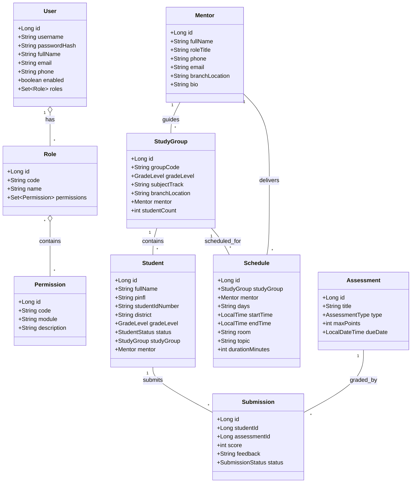

# 3. Initial Domain Model (Boshlang‘ich Domen Modeli)

DDD (Domain-Driven Design) tamoyillariga ko‘ra platformadagi asosiy entitilar, qiymat ob’ektlari (Value Objects) va agregatlar (Aggregates) chegaralari quyidagicha shakllantiriladi:

## 3.1. Agregatlar (Aggregates)

### 1. Identity & Access Aggregate
- **Aggregate Root:** `User`
- **Tarkibi:** `Role`, `Permission`, `UserRole`
- **Invariants:**
  - Foydalanuvchining login va emaili tizimda yagona (unique) bo‘lishi shart.
  - Har qanday autentifikatsiyadan o‘tgan foydalanuvchida kamida 1 ta rol bo‘lishi lozim.

### 2. Education Structure Aggregate
- **Aggregate Root:** `StudyGroup`
- **Tarkibi:** `Room`, `BranchLocation`
- **Invariants:**
  - Guruh kodi (masalan, `YA-26I0804`) takrorlanmasligi kerak.
  - Guruh ma’lum bir sinf darajasi (`8-sinf`, `9-sinf`, `10-sinf`, `11-sinf`) va ta’lim filialiga biriktiriladi.

### 3. Mentor & Teaching Aggregate
- **Aggregate Root:** `Mentor`
- **Tarkibi:** `MentorProfile`, `Specialization`
- **Invariants:**
  - Mentor bir vaqtning o‘zida bir nechta o‘quv guruhiga tayinlanishi mumkin.

### 4. Student Aggregate
- **Aggregate Root:** `Student`
- **Tarkibi:** `Pinfl`, `StudentIdNumber`, `AcademicStatus`
- **Invariants:**
  - PINFL (JSHSHIR) 14 xonali raqam bo‘lishi va unikal tekshirilishi kerak.
  - O‘quvchi o‘z sinf darajasiga mos guruhda o‘qiydi.

### 5. Schedule & Timetable Aggregate
- **Aggregate Root:** `Schedule`
- **Tarkibi:** `TimeSlot`, `DaySchedule`, `CurriculumTopic`
- **Invariants:**
  - Bitta xonada va bitta vaqt oralig‘ida ikkita dars to‘qnash kelmasligi (conflict detection) lozim.
  - Standart dars davomiyligi: 80 daqiqa (4 bosqich: Tushunish, Amaliyot, Loyiha, Natija).

### 6. Assessment & Grading Aggregate
- **Aggregate Root:** `Assessment` va `Submission`
- **Invariants:**
  - To‘plangan ball maksimal ball miqdoridan oshib keta olmaydi.
  - Baho faqat vakolatli mentor yoki tizim tekshiruvchisi tomonidan o‘rnatiladi.
