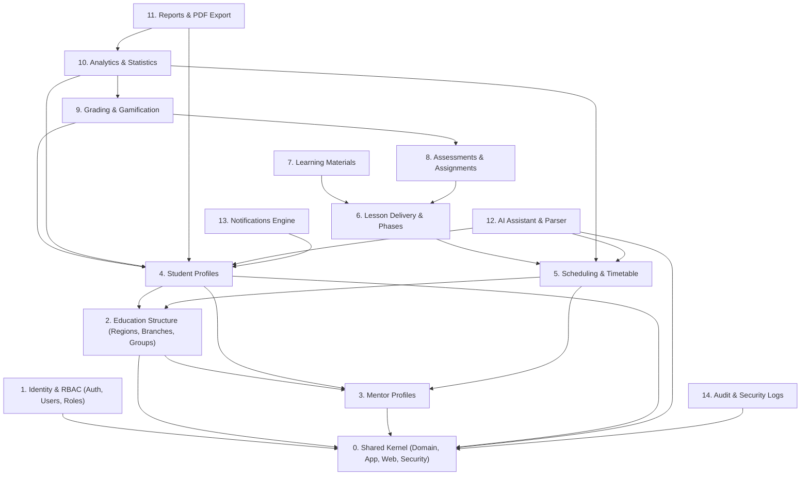

# 4. Module Dependency Map (Modullar Bog‘liqlik Xaritasi)

Modular Monolith arxitekturasida modullar o‘rtasida aylanma bog‘liqliklar (circular dependencies) qat’iyan taqiqlanadi. Barcha aloqalar faqat bir tomonlama (Directed Acyclic Graph) bo‘lishi lozim.

## 4.1. Modullararo Aloqa Qoidalari

1. **Repositoryga to‘g‘ridan-to‘g‘ri murojaat taqiqlanadi:**
   - Masalan, `Scheduling` moduli bevosita `UserRepository` yoki `StudentRepository` ni chaqira olmaydi.
   - Buning o‘rniga `StudentApplicationService` orqali taqdim etilgan DTO va metodlardan foydalaniladi.

2. **Domen Voqealari (Domain Events):**
   - Asinxron yoki zaif bog‘langan (loosely-coupled) amallar uchun Spring Event Publisher (`ApplicationEventPublisher`) ishlatiladi.
   - Misol: `StudentAssignedEvent`, `GradeCalculatedEvent`, `ScheduleUpdatedEvent`.

3. **API Chegaralari:**
   - Har bir modul o‘zining `application` paketida boshqa modullar uchun ommaviy xizmat interfeysini e’lon qiladi. Ichki implementatsiya detallari yashirin qoladi.
