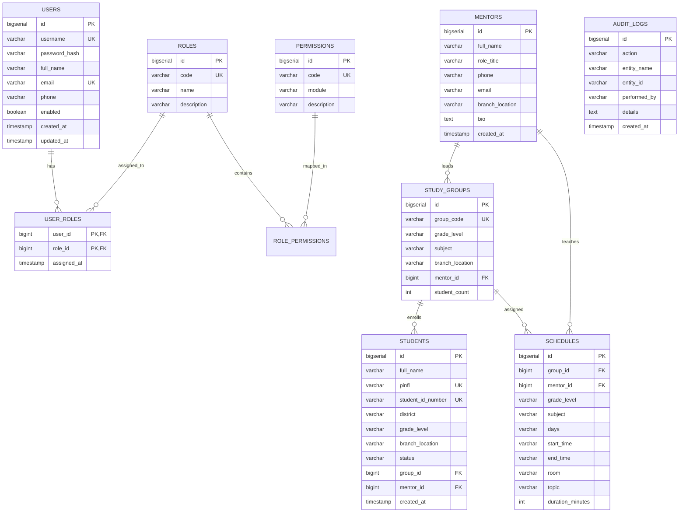

# 5. Database Design Proposal (Baza Strukturasi Taklifi)

PostgreSQL 16 asosiy ma’lumotlar bazasi hisoblanadi. Barcha jadvallar Liquibase migratsiyalari orqali boshqariladi.

## 5.1. Indekslar va Cheklovlar (Indexes & Constraints)
1. **Unikallik indekslari:**
   - `users(username)` va `users(email)`
   - `students(pinfl)` va `students(student_id_number)`
   - `study_groups(group_code)`
   - `roles(code)`, `permissions(code)`

2. **Qidiruv va Foreign Key indekslari:**
   - `idx_students_group_id` -> `students(group_id)`
   - `idx_students_mentor_id` -> `students(mentor_id)`
   - `idx_schedules_mentor_id` -> `schedules(mentor_id)`
   - `idx_schedules_group_id` -> `schedules(group_id)`
   - `idx_audit_created_at` -> `audit_logs(created_at)`

## 5.2. Vaqt va O‘chirish Siyosati (Timestamp & Retention)
- Barcha vaqtlar (`created_at`, `updated_at`) UTC vaqt mintaqasida (`NOW() AT TIME ZONE 'UTC'`) saqlanadi.
- Frontendga ISO-8601 UTC formatida uzatiladi va foydalanuvchining lokal vaqtiga moslab ko‘rsatiladi.
- Talaba va baholar kabi muhim ta’lim ma’lumotlari uchun jismoniy o‘chirish (Hard Delete) taqiqlanadi; `status` yoki `is_deleted` orqali Soft Delete amalga oshiriladi.
