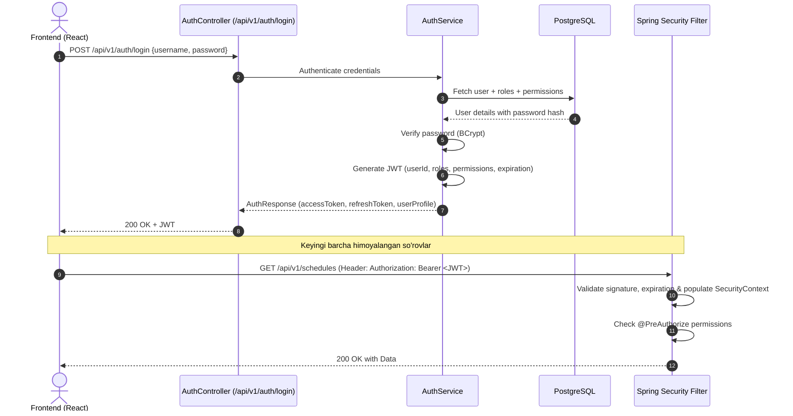

# 7. Authentication & Authorization Strategy (Xavfsizlik Strategiyasi)

## 7.1. Ko‘p Rolli RBAC (Multi-Role RBAC Model)
Har bir foydalanuvchiga bir vaqtning o‘zida bir nechta rol biriktirilishi mumkin:
- `SUPER_ADMIN` — Platformaning to‘liq texnik va tizimli boshqaruvi.
- `PROGRAM_ADMIN` — Davlat dasturi rahbariyati va tahlilchilar.
- `REGIONAL_COORDINATOR` — Hududiy IT Park va maktablar bo‘yicha taqsimot boshqaruvchisi.
- `MENTOR` — Dars jadvali, dars o‘tish, topshiriqlar va baholash.
- `STUDENT` — O‘quvchi portali, dars materiallari, test topshirish va natijalar.
- `CONTENT_MANAGER` — O‘quv rejalari va metodik materiallarni kirituvchi.
- `OBSERVER` — Audit va monitoring uchun cheklangan o‘qish huquqi.

## 7.2. Autentifikatsiya Oqimi (Stateless JWT Authentication)


## 7.3. Ma’lumotlar Doirasini Himoyalash (Data-level Authorization & IDOR Protection)
Faqat rolga ega bo‘lish yetarli emas. Har bir so‘rovda ma’lumotlar doirasi (Scope) tekshiriladi:
- **Mentor:** Faqat o‘ziga biriktirilgan guruhlar va o‘quvchilar ma’lumotlarini ko‘rish va tahrirlash huquqiga ega.
- **O‘quvchi:** Faqat o‘zining dars jadvali, baholari va topshiriqlarini ko‘ra oladi (boshqa o‘quvchining ID sini so‘rovda yuborish orqali ma’lumot olish — IDOR ning oldi olinadi).
- **Tekshiruv:** Application qatlamida xavfsizlik kontekstidan olingan `currentUserId` tekshiriladi:
  ```java
  @PreAuthorize("hasAuthority('SCHEDULE_MANAGE') or (hasRole('MENTOR') and #mentorId == authentication.principal.id)")
  ```
