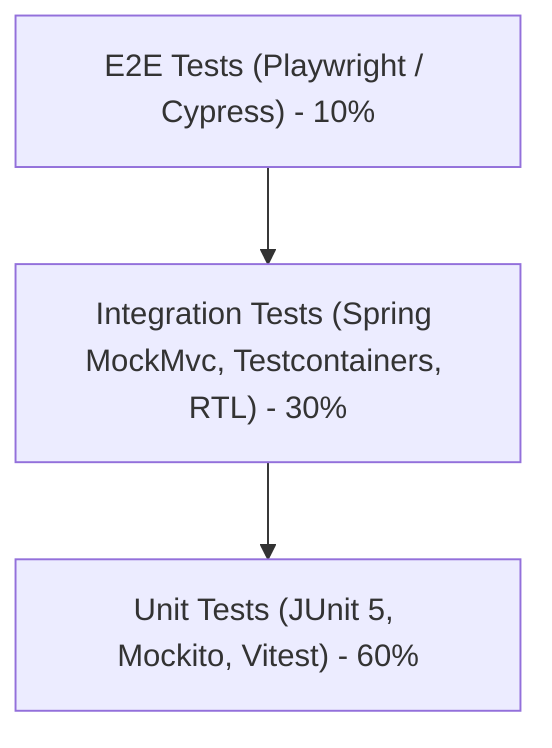

# 9. Testing Strategy (Testlash Strategiyasi)

Ishonchli va buzilmas tizim yaratish uchun testlash piramidasi qat’iy tashkil qilinadi:

## 9.1. Backend Testlash
1. **Unit Tests (Birlik testlar):**
   - Framework: **JUnit 5** va **Mockito**.
   - Domen modellari va hisob-kitoblar (ballar, davomat, foizlar) sof holda testlanadi.
   - Tezlik: Bir necha millisekundda bajariladi.

2. **Web Slice & Controller Tests:**
   - Framework: `@WebMvcTest` va `MockMvc`.
   - HTTP so‘rovlari, JSON validatsiyasi, xato javoblari va xavfsizlik filtrlari tekshiriladi.
   - Misol: `HealthControllerTest` tizim sog‘lomligini tekshiradi.

3. **Data & Repository Tests:**
   - Framework: `@DataJpaTest` yoki `@SpringBootTest`.
   - Mahalliy tezkor testlar uchun `H2` (PostgreSQL rejimida), to‘liq integratsiya uchun esa **Testcontainers PostgreSQL** ishlatiladi.

## 9.2. Frontend Testlash
1. **Statik Tekshiruv (Static Analysis):**
   - `tsc -b` (TypeScript qat’iy turlar tekshiruvi).
   - `eslint .` (ESLint qoidalari va React Hooks xavfsizligi).
2. **Komponent va Hook Testlari:**
   - **Vitest** va **React Testing Library** yordamida izolyatsiyalangan UI komponentlar render qilinishi va foydalanuvchi hodisalari tekshiriladi.

## 9.3. Avtomatlashtirilgan CI/CD (GitHub Actions)
Har bir `push` va `pull_request` paytida quyidagi qadamlar bajariladi:
1. Backend: `./gradlew check` va `./gradlew test`.
2. Frontend: `npm run lint` va `npm run build`.
3. Barcha tekshiruvlar muvaffaqiyatli o‘tmasdan kod asosiy tarmoqqa qo‘shilmaydi.
