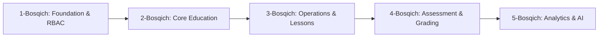

# 10. Development Roadmap (Rivojlanish Yo‘l Xaritasi)

17 ta platforma modullari ularning o‘zaro bog‘liqligi (dependency-first) asosida 5 ta mantiqiy bosqichga taqsimlandi:

## 1-Bosqich: Arxitektura Poydevori va Xavfsizlik (Foundation & Security)
* [x] **Modul 1: Project Foundation:** Java 21 + Spring Boot 4 / Gradle, React 19 + Vite + Tailwind, Docker Compose, `.env.example`, Actuator va `/api/v1/health` endpointi, toza testlar va linter tekshiruvi. *(Hozirgi bajarilgan bosqich)*
* [ ] **Modul 2: Design System & Shared UI:** shadcn/ui va Radix asosidagi qayta ishlatiluvchi komponentlar, tipografiya va ranglar palitrasi.
* [ ] **Modul 3 & 4: Multi-role Authentication & RBAC:** Haqiqiy JWT tokenlar, foydalanuvchilar reyestri, 7 ta davlat dasturi rollari va ruxsatlar boshqaruvi.

## 2-Bosqich: Ta’lim Tuzilmasi va Foydalanuvchilar (Core Education Structure)
* [ ] **Modul 5: Education Structure:** Hududlar, filiallar, sinf toifalari (8–11-sinflar) va guruhlar.
* [ ] **Modul 6: Mentor Profiles:** Mentorlarning profillari, unvonlari, tajribasi va biriktirilgan guruhlari.
* [ ] **Modul 7 (Users): Student Registry:** O‘quvchilar ro‘yxati, PINFL (JSHSHIR), talaba ID va holatlari.

## 3-Bosqich: Dars Jarayonlari va Taqsimot (Academic Operations)
* [ ] **Modul 8: Lesson Scheduling & Timetable:** Haftalik interaktiv dars jadvali, xonalar va to‘qnashuvlarni tekshirish.
* [ ] **Modul 9: Attendance Tracking:** Har bir dars uchun o‘quvchilar davomati va sababli/sababsiz ko‘rsatkichlar.
* [ ] **Modul 10: Lesson Planning (80-daqiqa standarti):** Tushunish, Amaliyot, Loyiha, Natija bosqichlari bo‘yicha dars rejalari.
* [ ] **Modul 11: Learning Materials:** O‘quv qo‘llanmalari, slaydlar va fayllarni yuklash hamda ko‘rish.

## 4-Bosqich: Baholash va Rag‘batlantirish (Assessments & Grading)
* [ ] **Modul 12: Tests & Assignments:** Test savollari, uy vazifalari va amaliy loyihalar.
* [ ] **Modul 13: Grading & Gamification:** Ballar hisob-kitobi, shaffof baholash qoidalari, yutuqlar (badges) va reytinglar (leaderboard).

## 5-Bosqich: Tahlil, AI va Boshqaruv (Intelligence & Governance)
* [ ] **Modul 14: Analytics & PDF Reports:** O‘zlashtirish tahlillari, OpenPDF orqali rasmiy hisobotlarni PDF formatida shakllantirish.
* [ ] **Modul 15: AI Assistant & Smart Parser:** Dars jadvallari va o‘quvchilarni tahlil qiluvchi aqlli AI dvigateli.
* [ ] **Modul 16: Notifications & Preferences:** Tizimli xabarnomalar, 3 tildagi lokalizatsiya (O‘zbek, Rus, Ingliz).
* [ ] **Modul 17: Administration & Audit Logs:** Har bir amaliyotning audit jurnali, xavfsizlik nazorati va production monitoring.
